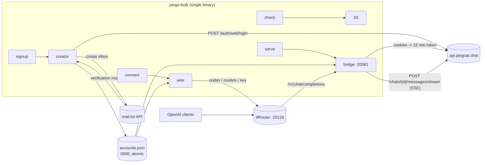
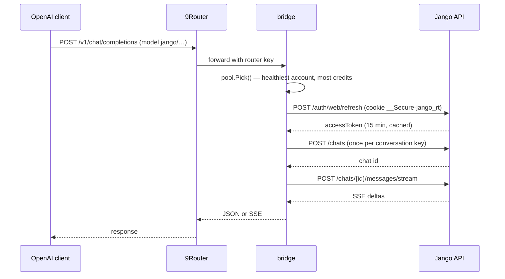

# Architecture

`jango-bulk` is a single Go binary that turns mail.tm inboxes into Jango AI
accounts, stores their session cookies, and serves the whole pool to 9Router as
one OpenAI-compatible endpoint.



## Request path



## Packages

| Path | Responsibility |
| --- | --- |
| `cmd/jango-bulk` | CLI entry point, flag parsing, command dispatch |
| `internal/mailtm` | disposable inboxes and mail polling (mail.tm REST) |
| `internal/jango` | typed Jango client: login, refresh, verify, chats, SSE, per-account cookie jar |
| `internal/creator` | signup pipeline (inbox → signup → verify → session capture), parallel workers |
| `internal/store` | JSON account store + JSONL audit log, `0600`, atomic replace |
| `internal/bridge` | OpenAI-compatible server, account pool, load balancing, conversation mapping |
| `internal/router` | 9Router dashboard client (node, connection, model alias, API key, verify) |
| `internal/wire` | export sessions and register them in 9Router |
| `internal/mock` | in-process fakes for mail.tm, Jango and 9Router |
| `internal/e2e` | end-to-end test: signup → capture → bridge → router → reply |

## Data files

```
data/
├── accounts.json           # accounts, cookies, tokens (0600)
├── accounts.json.audit     # append-only JSONL of every state change
└── bridge-sessions.json    # optional hand-off file for `serve`
```

Nothing leaves the machine except requests to mail.tm, Jango and the local
9Router instance.
